<div align="center">

```
     ██╗ █████╗ ███╗   ███╗██╗███████╗██╗     ██╗  ██╗   ██╗
     ██║██╔══██╗████╗ ████║██║██╔════╝██║     ██║  ╚██╗ ██╔╝
     ██║███████║██╔████╔██║██║█████╗  ██║     ██║   ╚████╔╝
██   ██║██╔══██║██║╚██╔╝██║██║██╔══╝  ██║     ██║    ╚██╔╝
╚█████╔╝██║  ██║██║ ╚═╝ ██║██║███████╗███████╗███████╗██║
 ╚════╝ ╚═╝  ╚═╝╚═╝     ╚═╝╚═╝╚══════╝╚══════╝╚══════╝╚═╝
```


<a href="https://www.linkedin.com/in/jamielly-reis/"></a>
<a href="https://github.com/Jamielly"></a>
<a href="https://web.dio.me/users/jamielly_reis"></a>
<a href="https://www.youtube.com/channel/UCYaWrmozMN48G_Z76H45RWg"></a>

</div>

---

## `whoami`


Sou a **Jamielly**, estudante de Software Engineering na **42 São Paulo**, interessada na interseção entre tecnologia, resolução de problemas e pesquisa.

- 🎓 Software Engineering @ 42 São Paulo
- 💻 Construindo e experimentando com C & Python
- 🤖 Explorando Inteligência Artificial e automação
- 🔬 Pesquisa científica e escrita técnica
- 🧩 Apaixonada por entender como as coisas funcionam por dentro

<br clear="right"/>

> 👻 "Não quero só fazer funcionar. Quero entender por que funciona."

---

## `42_school.exe`

<p align="center">


</p>

Aprendendo por projetos, colaboração peer-to-peer e muita pesquisa independente.

| Repositório | Conteúdo |
|:---|:---|
| [`Python_Module_0-4`](https://github.com/Jamielly/Python_Module_0-4) | Módulos 00–04 do Python |
| [`patibum-exam`](https://github.com/Jamielly/patibum-exam) | Guia de estudo — Exam Rank 02 |

---

## `👻 contribution.pacman()`

<div align="center">

<picture>
<source media="(prefers-color-scheme: dark)" srcset="https://raw.githubusercontent.com/Jamielly/Jamielly/output/pacman-contribution-graph-dark.svg"/>
<source media="(prefers-color-scheme: light)" srcset="https://raw.githubusercontent.com/Jamielly/Jamielly/output/pacman-contribution-graph.svg"/>

</picture>

</div>

---

## `compiler_flags` — stack

<p align="center">


<br/>


<br/>


<br/>


</p>

---

## `system.monitor()`

<div align="center">
<table>
<tr>
<td width="50%" align="center">

**Runtime Statistics**


</td>
<td width="50%" align="center">

**Commit Streak**


</td>
</tr>
</table>
</div>

---

## `featured_projects()`

🔮 **AITIA** — plataforma de aprendizado operacional com IA `Python` `Flask` `C`
🤖 **OpsPilot AI · JINSEI** — copiloto de IA para análise de incidentes `Python` `FastAPI` `RAG`
🐱 **CatEmpire** — jogo de estratégia procedural `Python` `Pygame`
⚡ **Hackathons & Experiments** — ideias, código e impacto `Teamwork`

<p align="center"><sub>→ mais nos <a href="https://github.com/Jamielly?tab=repositories">repositórios fixados</a></sub></p>

---

## `research.log`

<p align="center">


</p>

---

<div align="center">

```bash
$ ping jamielly --socials

LinkedIn ......... 200 OK
GitHub ........... 200 OK
DIO .............. 200 OK
YouTube .......... 200 OK

$ echo "obrigada pela visita!"
```

**✨ Aprendendo sem parar. Construindo sempre. ✨**


</div>
